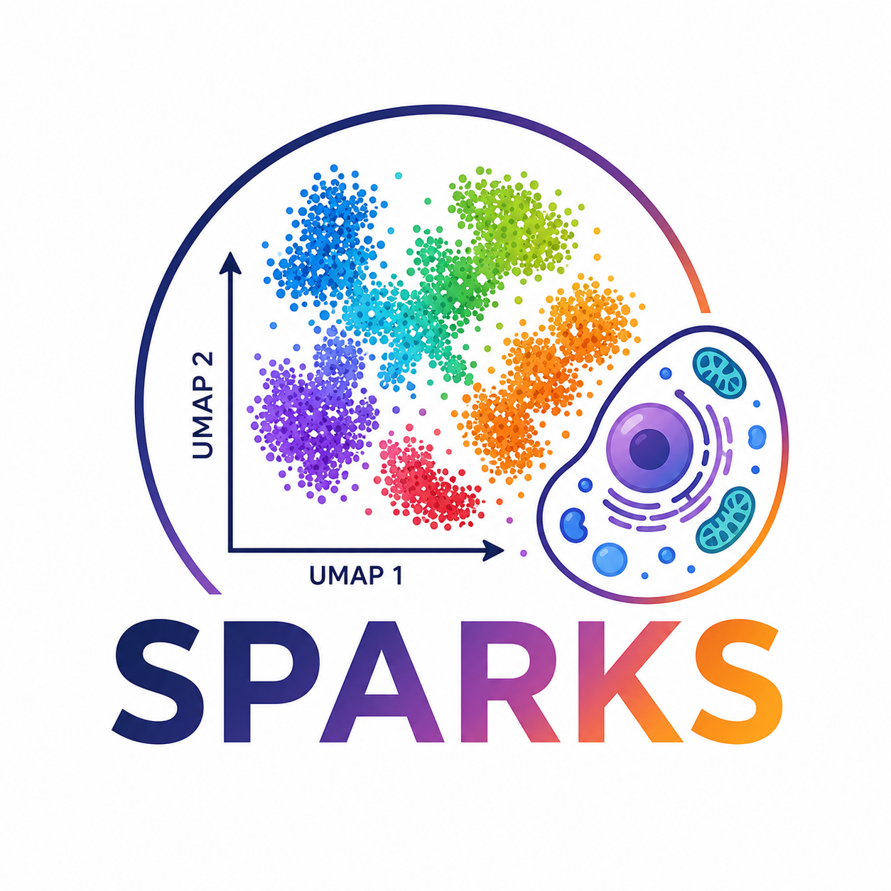

<p align="center">
  
</p>

<h1 align="center">SPARKS</h1>

<p align="center">
  Single-cell RNA-seq analysis toolkit
</p>

<p align="center">
  <a href="https://www.gnu.org/licenses/gpl-3.0">
    
  </a>
</p>

**SPARKS** (Single-cell Pipeline for Analysis of RNA-seq Systems) is a modular R package designed to streamline scRNA-seq analysis. It automates the workflow from raw count matrices (Alevin or Cell Ranger) to cluster identification, annotation, sex scoring, and differential expression analysis using **Seurat**, **SingleR**, and **scDblFinder**.

It provides an end-to-end framework for preprocessing, quality control, dimensionality reduction, clustering, visualization, and biological interpretation of single-cell transcriptomics datasets.

Species currently supported: **Human** and **Mouse**.

## Key Features

- **Automated Workflow**: Processes multiple samples and comparison groups in a single run.
- **Flexible Input**: Supports both 10X Genomics (Cell Ranger) and Alevin output formats.
- **Comprehensive QC**: Automated filtering based on mitochondrial content, feature counts, and doublet detection.
- **Cell Type Annotation**: Integrated SingleR support with customizable reference datasets.
- **Pathway Analysis**: Optional per-cell pathway scoring with `escape`, plus ranked MSigDB Hallmark GSEA from replicate-level edgeR pseudobulk statistics.
- **Advanced Scoring**: Built-in modules for sex scoring and cell cycle regression.
- **Subset Analysis**: Targeted re-clustering and analysis for specific cell populations defined in the config.
- **One dynamic HTML report**: `SPARKS_all_results.html` gathers every result of a run (QC, embeddings, genes, markers and DE, enrichment, composition, all tables, all figures, run log) in tabs with interactive plotly figures. It is a single self-contained file that works offline.
- **Loupe-style explorer**: a Shiny app (`sparks_explorer()`) where you lasso cells on the embedding and re-run differential expression, re-clustering, signature scoring and over-representation analysis on the fly. Analyses are cached [targets](https://docs.ropensci.org/targets/), so asking the same question twice is instant and the history survives restarts.

## Installation

You can install the development version of SPARKS from GitHub:

```r
# Install devtools if not already installed
if (!require("devtools", quietly = TRUE)) install.packages("devtools")

# Install SPARKS (dependencies = TRUE also pulls in the optional report and
# app packages: rmarkdown, knitr, DT, plotly, htmltools, base64enc, shiny,
# bslib, targets, callr, RColorBrewer)
devtools::install_github("lavauxt/SPARKS", dependencies = TRUE)
```

> **HTML reports (`QC_report_*.html` / `Results_report_*.html`)** are
> generated automatically at the end of each comparison group's run.
> They require the `rmarkdown` package (plus `DT`/`plotly`/`htmltools`/
> `RColorBrewer` for the interactive Results report). If you installed
> SPARKS without `dependencies = TRUE`, install them once with:
> ```r
> install.packages(c("rmarkdown", "knitr", "DT", "plotly", "htmltools", "RColorBrewer"))
> ```
> The `.Rmd` templates ship inside the installed package (`inst/rmd/`) and
> are located automatically — you no longer need to copy `qc_report.Rmd` /
> `results_report.Rmd` next to your config file for reports to generate.

## Try it without data

`sparks_demo_results()` writes a small synthetic results folder with the same
layout, file names and columns as a real run (three planted populations, four
samples, WT/KO conditions). The report flags it with a "Synthetic demo data"
badge.

```r
library(SPARKS)
demo <- tempfile("sparks_demo_")
sparks_demo_results(demo)

sparks_report(demo)      # writes <demo>/SPARKS_all_results.html
sparks_explorer(demo)    # opens the Shiny explorer on the same results
```

## The unified HTML report

After every run (`sparks()` or the targets workflow) SPARKS writes
`<results_dir>/SPARKS_all_results.html`. You can also (re)build it at any time
from any results folder:

```r
sparks_report("results")                                   # defaults
sparks_report("results", max_cells = 50000, embed_images = FALSE)
```

It is **one file with no server and no network dependency**: plotly.js is
inlined once, the data are embedded as JSON and each tab is drawn when you first
open it. Send it to a collaborator or open it from a shared drive.

| Tab | What it shows |
| :-- | :------------ |
| **Overview** | Headline numbers (cells, samples, genes, clusters, tables, files), overview figures, top markers per cluster, run details and jump links to the other tabs. |
| **QC** | Cells kept per filtering stage and sample, doublet statistics, QC figures. |
| **Embedding** | UMAP/t-SNE coloured by any metadata column or embedded gene. Lasso or box-select cells to get their composition, the genes higher in the selection, and the barcodes (download, copy, clear). Legend click toggles groups. |
| **Genes** | Violin and dot plots for the embedded genes, grouped by any categorical column. |
| **Markers & DE** | Cluster markers and DE tables with a live volcano plot (change the log2FC and adjusted p-value thresholds in the page). |
| **Enrichment** | GSEA and `escape` results. |
| **Composition** | Cell proportions per sample / condition and proportion tests. |
| **Tables** | Every result table of the run: sortable, filterable, CSV export. |
| **Figures** | The pipeline's PNG/SVG figures as a gallery with a lightbox. |
| **Files** | Index of every output file, and links to the per-comparison QC / Results reports. |
| **Run** | Configuration used, warnings, session info, log tail. |

Light, dark and automatic themes are available (button in the header), tabs are
keyboard-accessible and the URL hash remembers the open tab.

**Size and content are configurable** with arguments of `sparks_report()` or with
an optional `report:` block in the pipeline configuration (see the config
templates):

```yaml
report:
  title:           ~       # default: "SPARKS report - <results folder>"
  max_cells:       20000   # cells drawn in the embedding (random, seeded)
  max_genes:       60      # genes embedded for violin / dot plots
  max_table_rows:  3000    # rows kept per table in the report (files on disk are never truncated)
  embed_images:    true    # inline pipeline figures
  image_budget_mb: 25      # total size of inlined figures
  max_image_mb:    1.5     # largest single inlined figure
```

Notes:

* The report shows a **down-sampled panel** (`sparks_panel()`) of each merged
  Seurat object. Anything that needs the full data (DE on an arbitrary
  selection, re-clustering, any gene) is what the explorer is for.
* Palettes follow a fixed categorical order and are validated for colour-vision
  deficiency; with more than 8 categories the colours repeat as lighter tints
  and groups are labelled directly on the embedding.
* If `plotly`, `jsonlite`, `htmltools` or `base64enc` are missing, the pipeline
  falls back to the older static consolidated page and says so in the log.
* `generate_all_results_report()` now writes this same unified report.

## The explorer: a Loupe-style Shiny app

```r
sparks_explorer("results")                              # pick a dataset in the app
sparks_explorer("results", object = "results/Group_1/RData/Merged_Group_1.rds")
```

The explorer is also available as the **Explorer** page of `sparks_app()`, and
as a Shiny module (`sparks_explorer_ui()` / `sparks_explorer_server()`) to embed
in your own app.

What you can do:

1. **Look**: choose the dataset and reduction, colour by any metadata column
   *or any gene*, change point size and opacity.
2. **Select**: lasso/box-select on the embedding, paste or upload barcodes, or
   save a selection as a named **category** (it then becomes a colour-by column).
3. **Ask a question** about the selection, on the fly:
   * **Differential expression** of the selection against everything else or
     against another saved category (Wilcoxon, with `min_pct` and log2FC
     thresholds).
   * **Re-cluster** the selection (normalise, PCA, clusters, UMAP, optional
     markers); apply the new clusters as a colour-by column.
   * **Signature scoring**: score a gene list per cell (module score, or mean
     z-score as fallback); signatures from your configuration or a pasted list.
   * **Over-representation** of the up-regulated genes of a DE result in your
     configured signatures or a GMT file.
4. **Keep and share**: every analysis is listed in a history (status, run time,
   errors), can be reopened, downloaded as CSV, and is included in the report
   when you click **Build unified report**.

### How it uses targets

Interactive analyses are targets, in their **own store**
`<results_dir>/_targets_interactive/` so exploring never invalidates, or races
with, the production pipeline in `<results_dir>/_targets/`.

* An analysis is described by `sparks_spec()`; its id is a **content hash** of
  the parameters and the object it runs on.
* All analyses depend on one file target, the merged Seurat object: asking the
  same question twice is a cache hit, and replacing the object invalidates
  every analysis built from it.
* A failed analysis is recorded (`error = "continue"`) and shown in the history
  without blocking the others. Like any failed target it is retried by the next
  run; delete it from the history once you no longer want it.
* With SPARKS **installed** (not only loaded with `devtools::load_all()`) and
  `callr` available, analyses run in a background R process so the app stays
  responsive; otherwise they run in the app's own process.

The same machinery is available from scripts:

```r
spec <- sparks_spec("de", cells_a = my_barcodes, label = "Region A vs rest")
sparks_interactive_submit("results", spec, object_path)
sparks_interactive_run("results", object_path)       # builds only what is not cached
sparks_interactive_status("results")                 # id, type, label, status, seconds
res <- sparks_interactive_result("results", sparks_interactive_status("results")$id[1])
res$table
```

Other building blocks are exported too: `sparks_read_results()` (index a results
folder), `sparks_table()`, `sparks_panel()`, the plotly figure builders
(`sparks_fig_*()`), `sparks_read_gmt()` and `sparks_read_barcodes()`.

## Quick Start

### Interactive interface and resumable runs

Install the optional interface/workflow packages (`shiny`, `bslib`, `DT`,
`targets`, `callr`, `htmltools`, and `base64enc`) and launch the app with:

```r
SPARKS::sparks_app()
```

The app accepts a base configuration, optional override YAML and sample table,
validates settings with the package's regular validators, launches the targets
workflow in a background R process, and provides a searchable results catalog
with per-file downloads. The run page displays validation/launch state, a
timestamped log, elapsed time, and live target progress. Guided controls cover
common settings, while the YAML editor supports the full configuration. After
validation, choose specific targets or leave the selection empty to run the
complete workflow. Dependencies of selected targets run as needed.
`SPARKS::run_sparks_targets()` accepts the same optional `target_names` argument.
Targets are stored under
`<results_dir>/_targets/`; completed targets are reused when their tracked
configuration and input files are unchanged. A store lock prevents concurrent
SPARKS runs from writing to the same results directory.

The **Overview** page summarizes output files by group/type and, for saved
merged Seurat objects, provides a UMAP explorer colored by metadata or selected
gene expression. Install optional package `plotly` for hover and lasso selection;
metadata-selected cells can be downloaded as TSV. The **Explorer** page opens a
results folder in the full [explorer](#the-explorer-a-loupe-style-shiny-app)
(selection, on-the-fly DE, re-clustering, signature scoring, enrichment).

The workflow also creates `SPARKS_all_results.html`, the
[unified interactive report](#the-unified-html-report). The Shiny results browser
also supports exporting tabular results as CSV or TSV.

```r
SPARKS::run_sparks_targets(
  base_config_path = "./inst/config_template_mouse.yaml",
  override_config_path = "./inst/examples/config_RANK.yaml"
)
```

The existing sequential `sparks()` API remains available and is unchanged.

### 1. Prepare your Sample Table
Create a `sample_table.tsv` defining your data folders and experimental conditions:

| folder_id | protocol | comparison_group |
| :-------- | :------- | :--------------- |
| Sample_A  | WT       | Group_1          |
| Sample_B  | KO       | Group_1          |

### 2. Configure the Pipeline
Copy the provided mouse template and modify it for your study. You can override specific parameters (e.g., QC thresholds, resolution) in a separate YAML file.

### 3. Run the Pipeline

The package `sparks()` runner continues to work as before. To launch a
resumable target-based run or the Shiny UI, see [Interactive interface and
resumable runs](#interactive-interface-and-resumable-runs).

```{r run-sparks, eval=FALSE}
library(SPARKS)

# Run the complete analysis
# For the RANK mouse dataset
sparks(
  base_config_path     = "./inst/config_template_mouse.yaml",
  override_config_path = "./inst/examples/config_RANK.yaml"
)

# For the GSE178272 human dataset
sparks(
  base_config_path     = "./inst/config_template_human.yaml",
  override_config_path = "./inst/examples/config_GSE178272.yaml"
)
```

## Configuration

The entire analytical pipeline is governed via a structured YAML configuration 
matrix. Below is a detailed mapping of the block structure parameters.

* Project Ingestion Landscape (pipeline)
Maps workspace directory contexts, target organisms, and metadata registry links.
```
  pipeline:
    data_dir: "./datas"             # Source directory tracking raw count roots
    results_dir: "./results"        # Target directory for all output files
    species_target: "Mouse"         # Organism directive ("Mouse" or "Human")
    sample_table: "./sample_table.tsv"  # File path to sample tracking matrix
```
*  Organism Profile Criteria (species)
Tracks sequence element clearance filters and establishes reference parameters 
for cell type taxonomy annotations.
```
  species:
    gene_removal_pattern: "^(Rps|Rpl|Rrn|Rn|Hb|Gm).*|.*Rik$" # Clears noise transcripts
    mt_pattern: "^mt-"                                      # Identifies mitochondrial genes
    genes_to_remove: ["Xist", "Tsix", "Kdm6a"]              # Explicit blacklist array
    ref_primary: "ImmGenData"                               # Primary SingleR reference
    ref_secondary: "MouseRNAseqData"                        # Secondary SingleR reference
```
*  Covariate Evaluation Systems (sex_scoring & cell_cycle)
Enables biometric state evaluations and directs downstream regression scaling.
```
  sex_scoring:
    run: true               # Calculates individual sex representation scores
    regress: true           # Regresses out sex-linked expression variation during scaling
    markers:
      female: ["Xist", "Tsix", "Kdm6a"]
      male: ["Eif2s3y", "Ddx3y", "Uty"]

  cell_cycle:
    run: true               # Quantifies cell cycle metrics
    regress: true           # Regresses out cell cycle signatures to avoid cell cycle confounding
```
*  Technical Quality Control Boundaries (qc)
Establishes rigid thresholds for filtering out low-quality cell events and 
transcript artifacts.
```
  qc:
    min_features: 200       # Minimum unique gene count required per cell
    max_counts: 30000       # Maximum acceptable depth profile tracking UMIs
    max_mt_percent: 10      # Percentage ceiling for mitochondrial transcript ratios
    min_cells: 3            # Baseline gene feature filtering requirement
```
*  Seurat Dimensional Scaling Matrix (processing)
Directs down-stream cluster processing, community partitioning, and dimensionality reductions.
```
  processing:
    vars_to_regress: ["percent.mt"]  # Non-genomic metadata covariates to regress out
    pca_dims_from: 1                 # Evaluation start index for PCA space
    pca_dims_to: 20                  # SNN graph build dimension ceiling
    npcs: 50                         # Total principal components computed initially
    cluster_resolution: 0.5          # Louvain modularity clustering resolution scale
    reduction: "umap"                # Low-dimensional embedding selection
```
*  Differential Gene Discovery (deg)
Configures strict statistical criteria used for identifying differentially expressed markers.
```
  deg:
    logfc_threshold: 0.25            # Minimum natural log fold-change cut-off
    min_pct: 0.1                     # Minimum feature detection frequency in target groups
    min_cells_per_group: 10          # Processing representation limit to qualify for testing
    min_p_val_adj: 0.01              # Adjusted significance ceiling limit
    avg_expression_layers: ["data", "counts"] # Layer extractions checked during analysis
```
*  Reference Classification Horizons (singler)
Maps classification targets, dictionary scopes, and matching conditions.
```
  singler:
    unassigned_label: "Unassigned"   # Label applied when correlation metrics match poorly
    min_cells_per_group: 10          # Population limits guiding assignment testing
    labels:
      - name: "singleR_labels_main"
        ref_field: "label.main"      # Broad lineage designation category mapping
        is_fine: false
      - name: "singleR_labels_fine"
        ref_field: "label.fine"      # High-resolution lineage designation mapping
        is_fine: true
```
*  Functional Enrichment Architecture (escape)
Orchestrates functional enrichment scoring routines via internal MSigDB parsing.
```
  escape:
    run: true
    method: "AUCell"                # Analytical engine selection ("AUCell", "UCell", "ssGSEA", "GSVA")
    library: ["H", "C5"]            # Focus databases targeted (e.g., Hallmark, Gene Ontology)
    min_size: 5                     # Minimum dimensional gene pathway footprint filter
```
*  Feature Target Registries (genes)
Directs automated expression tracing visualization outputs and coordinate matrix calculations.
```
  genes:
    genes_to_plot:                  # Global registry driving FeaturePlot/Violin generation
      - "Sphk1"
      - "Cd19"
      - "Cd3e"
    corr_genes_x: ["S1pr1", "S1pr2"] # Coordinate factors driving expression correlation matrices
    corr_genes_y: ["Ccl19", "Cxcl13"]
```
*  Gene Signature Panels (gene_signatures)
Named gene lists that get a dedicated per-cell z-score heatmap, an averaged
z-score heatmap, and a DotPlot (average expression + percent expressed)
automatically generated for **every grouping column** — `seurat_clusters`,
every SingleR label column, and every subset's own cluster/type column —
of **both** the Main analysis unit and every subset/subcluster defined below.
No extra wiring per subset is needed: add a signature once and it is applied
everywhere.
```
  gene_signatures:
    - name: "Lipid_Scavenger"
      genes: ["Cd36", "Ackr3", "Ackr4", "Plpp3", "Stab1", "Stab2", "Cav1", "Cav2", "Dab2"]
    - name: "Vascular_Tightness"
      genes: ["Cdh5", "Cldn5", "Pdgfa", "Pdgfb", "Tek", "Tjp1", "Wnt2", "Emcn"]
```
Output (per grouping column `<group_col>`, per analysis unit `<Main|SubsetName>`):
```
<Main|SubsetName>/<group_col>/Heatmap/
  ├── <Unit>_<group_col>_<Signature>_Heatmap_PerCell.png    # z-score per cell
  ├── <Unit>_<group_col>_<Signature>_Heatmap_Aggregated.png # z-score averaged per group
  └── <Unit>_<group_col>_<Signature>_DotPlot.png            # avg expression + % expressed
```
Genes not present in the dataset are skipped automatically (with a message);
a signature is skipped entirely if fewer than 2 of its genes are found, or if
the grouping column has fewer than 2 groups.

*  Declarative Sub-Clustering Directives (subsets)
Defines cell population routing rules for automated secondary extraction, 
re-clustering, and sub-population profiling.
```
  subsets:
    - display_name: "Fibroblasts"
      match_col: "singleR_labels_main"   # Targeting metadata column
      pattern: ["Fibroblasts"]           # Target pattern used for routing extraction
      exact_match: true                  # Strict array text validation matching
      type_col: "fibroblast_type"        # Assigned sub-clustering metadata tracking slot
      pca_dims_from: 1                   # Dedicated sub-space calculation dimensions start
      pca_dims_to: 10                    # Dedicated sub-space calculation dimensions stop
      color: "darkgreen"                 # Color mapping tracking parameter
      genes: ["Ccl19", "Cxcl13"]         # Subpopulation targeted gene expression tracking set
      label_rules: []                    # Optional rule modifiers
```
*  Interactive Report (report)
Optional. Sizes the unified HTML report; every key has a default (see
[The unified HTML report](#the-unified-html-report)).
```
  report:
    max_cells: 20000                # cells drawn in the interactive embedding
    max_genes: 60                   # genes embedded for violin / dot plots
    max_table_rows: 3000            # rows kept per table in the report
    embed_images: true              # inline the pipeline's figures
```

## Differential expression and pathway analysis

The default `deg$run: true` retains the existing cell-level Seurat Wilcoxon
comparison. Since cells are not biological replicates, use this as exploratory
cell-level analysis rather than replicate-level inference. Set `pseudobulk$run:
true` to additionally fit edgeR quasi-likelihood models to raw RNA counts summed
by biological sample and group. This requires at least two samples per condition
by default; designs that do not meet the requirements are skipped with a reason.

Ranked Hallmark GSEA (`gsea$run: true` by default) uses those edgeR pseudobulk
statistics. It does not fall back to cell-level ranks. If edgeR, `fgsea`,
Hallmark sets, or a valid replicate design is unavailable, the log reports why
GSEA was skipped. Per-cell `escape` scoring is a separate analysis controlled
by `escape$run`; its default library is Hallmark (`H`). Harmony remains the
batch-integration method for clustering and is not a differential-expression or
enrichment test.

By default, the pipeline also writes embedding projections for the top 10
Hallmark pathways, with each group's normalized enrichment score (NES) mapped
to its cells on the UMAP. This is a visualization of **group-level** pseudobulk
results, not per-cell pathway activity. Set `gsea$plot_projection: false` to
disable these figures, or change `gsea$projection_top_n`. Optional t-SNE
coordinates can be computed alongside UMAP with `processing$run_tsne: true`;
when available, the same GSEA projection plots are also written on t-SNE. The
t-SNE perplexity is automatically capped for small datasets and can be tuned
with `processing$tsne_perplexity`.

Analysis outputs use separate sibling folders under each grouping: `DEG/`,
`Pseudobulk/`, `Expression/`, `Proportions/`, `Correlation/`, and `GSEA/`.
Each run also records console messages in `pipeline.log` and writes genuine R
warnings to `warnings.txt`; the HTML reports include the current run's available
analysis tables and a concise diagnostics section. Older table files are not
mistaken for current-run results.

## Output Structure

The pipeline generates an organized results directory:
```
results_dir/
  ├── SPARKS_all_results.html                # Unified interactive report (all tabs)
  ├── config_used.yaml                       # Configuration the run used (also read by the report)
  ├── _targets/                              # Resumable pipeline store (targets workflow)
  ├── _targets_interactive/                  # Cached explorer analyses (specs + store)
  └── Group_1/
      ├── QC/
      │   ├── VlnPlot_Group_1.png            # Ingestion profile distributions
      │   ├── ScatterPlot_Group_1.png        # Depth vs feature count tracking
      │   └── QC_report_Group_1.html         # Auto-generated QC HTML report
      ├── Main/                              # (repeated per subset, e.g. Fibroblasts/, Endothelial/)
      │   └── seurat_clusters/               # (repeated per grouping: singleR labels, type_col, ...)
      │       ├── UMAP/
      │       │   ├── UMAP_Main_seurat_clusters.png
      │       │   └── UMAP_DEG_Main_seurat_clusters.png
      │       ├── DEG/
      │       │   └── AllMarkers_Main_seurat_clusters.txt
      │       ├── VlnPlot/
      │       └── Heatmap/
      │           ├── ZScore_TopGenes_Main_seurat_clusters.png
      │           ├── ExprHeatmap_Main_seurat_clusters.png
      │           ├── Main_seurat_clusters_Lipid_Scavenger_Heatmap_PerCell.png
      │           ├── Main_seurat_clusters_Lipid_Scavenger_Heatmap_Aggregated.png
      │           ├── Main_seurat_clusters_Lipid_Scavenger_DotPlot.png
      │           ├── Main_seurat_clusters_Vascular_Tightness_Heatmap_PerCell.png
      │           ├── Main_seurat_clusters_Vascular_Tightness_Heatmap_Aggregated.png
      │           └── Main_seurat_clusters_Vascular_Tightness_DotPlot.png
      ├── Escape/
      │   ├── Enrichment_Scores.tsv          # Pathway scores per single cell
      │   └── Pathway_Heatmap.png            # Cluster-averaged pathway enrichment profiles
      ├── Results_report_Group_1.html        # Auto-generated interactive Results HTML report
      └── RData/
          └── Group_1_Seurat_Processed.rds   # Production-ready Seurat binary object file
```

## Tests

```r
devtools::test()                       # or testthat::test_local()
```

The suite covers the results index, the plotly figure builders, the report
(self-contained, valid JSON data block, one copy of plotly.js, capped tables,
embedded images, fallback), the on-the-fly analyses and their targets store
(caching, error capture, history across sessions) and the explorer's server
logic (`shiny::testServer`). It runs on the synthetic data of
`sparks_demo_results()`, so it needs no dataset; tests skip when an optional
package (Seurat, plotly, targets, ...) or `node` (JavaScript syntax check) is
not installed. A browser smoke test of the report and the explorer with
Playwright is in `tests/browser/`.

The full pipeline (`sparks()`) is not exercised by the unit tests: it needs the
reference data and the Bioconductor stack and is run on your own data.

## License

This project is licensed under the [GNU General Public License v3.0](LICENSE).